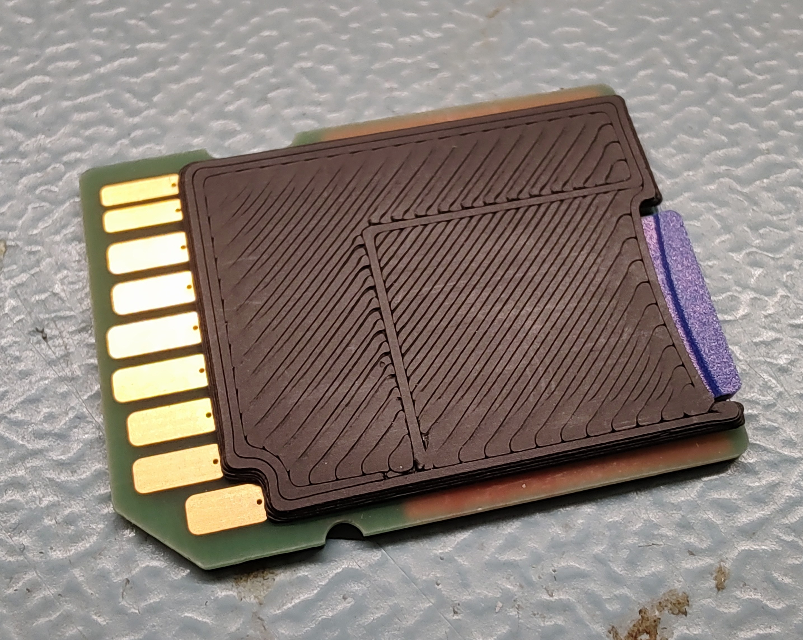
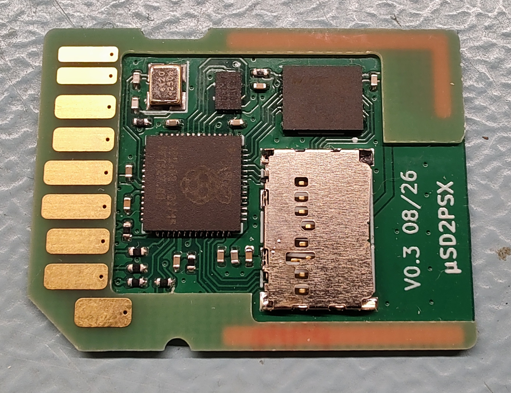
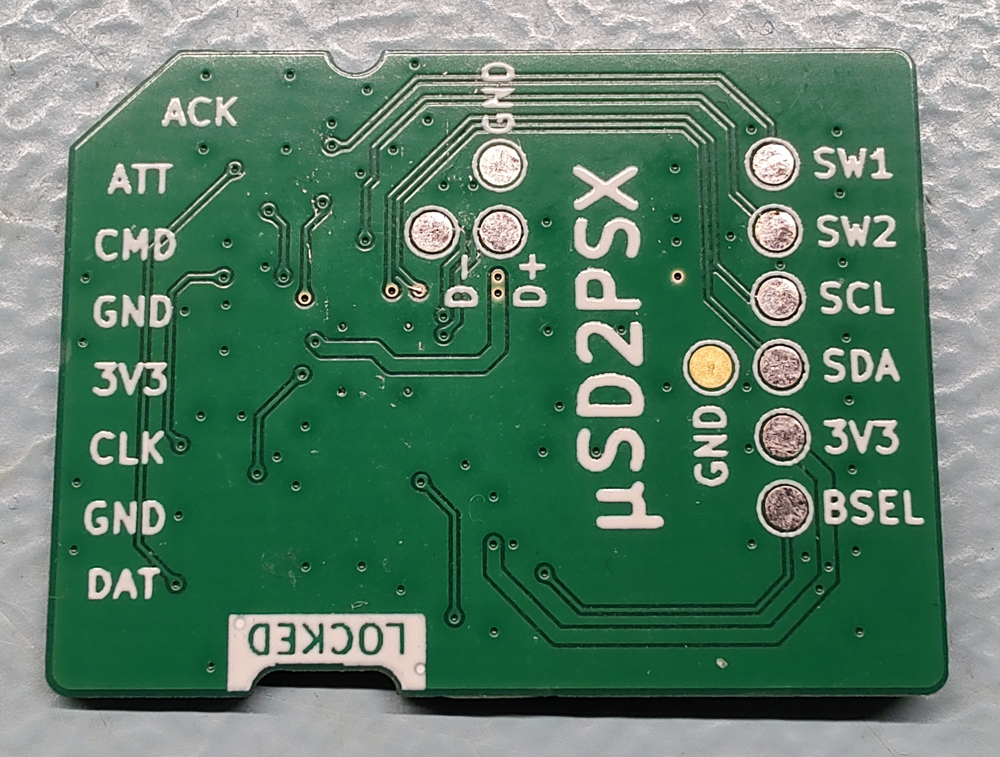
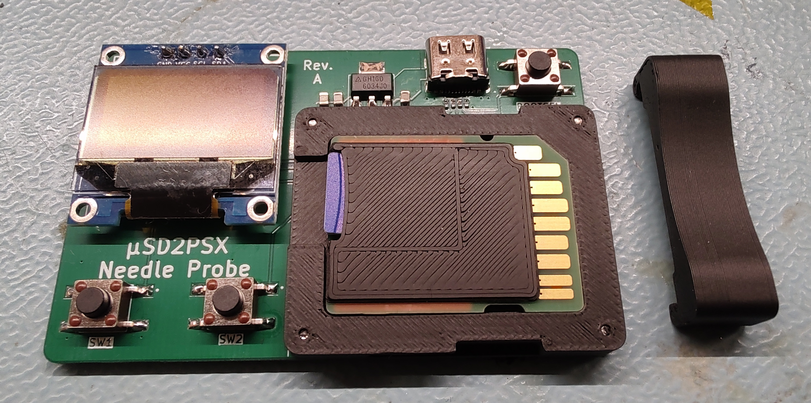
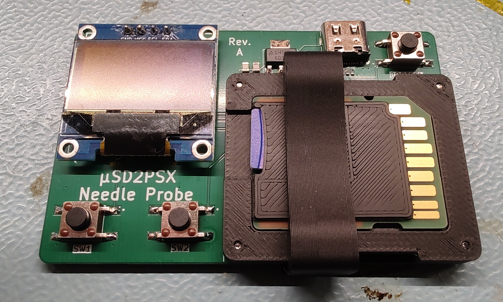
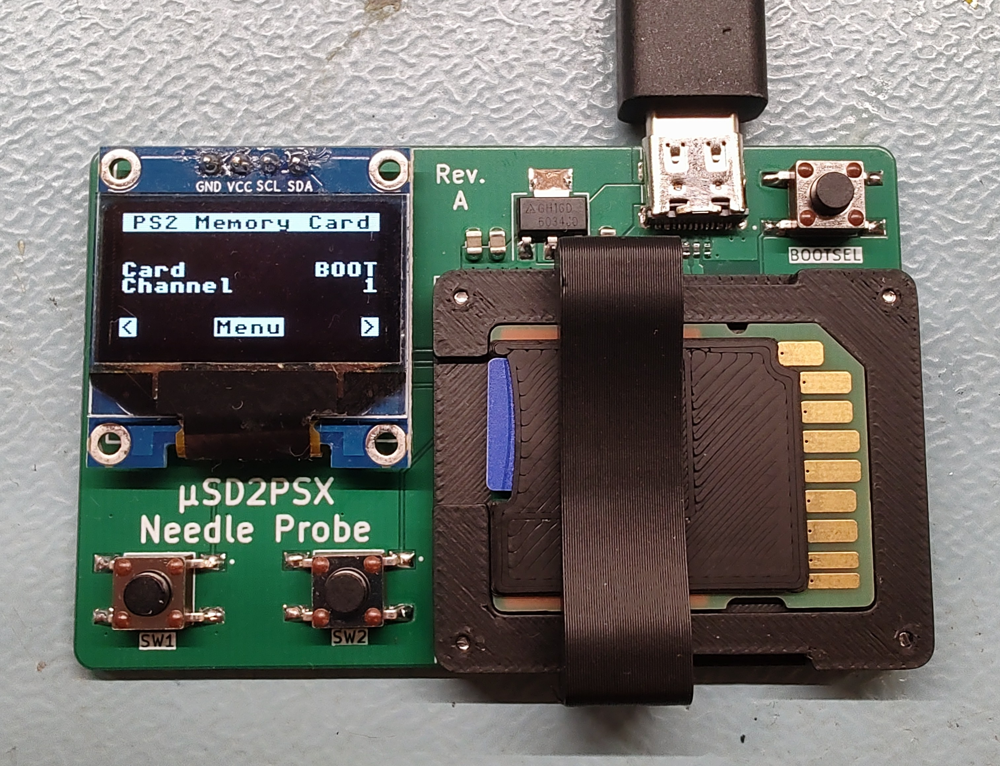
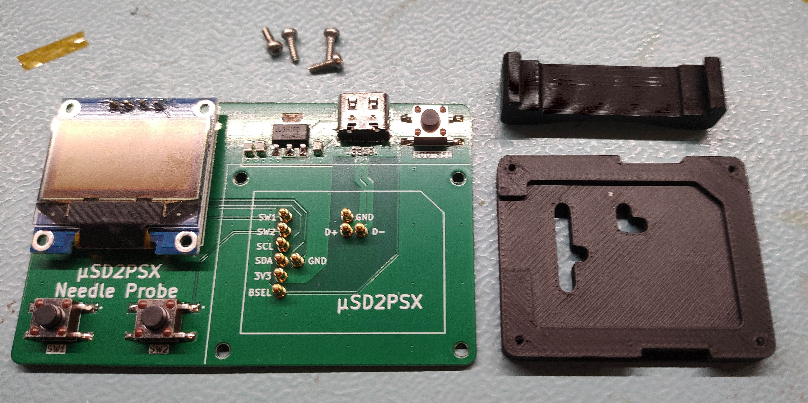
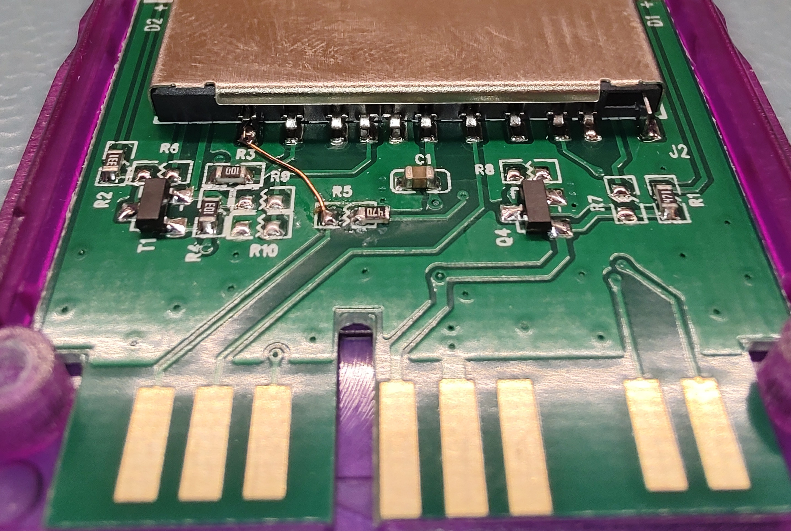

# About This Project

This variant of the [SD2PSX](https://github.com/sd2psx) is made specifically as an accessory for my PlayStation 2 portable.  
- Its electronics are based on and essentially 1:1 compatible to the original SD2PSX.  
- Form factor and pinout match an SD card, with one deviation: PS2 memory cards have an ACK signal that SD cards do not have - this is connected to pin 9, instead of DAT2.  
- While the *uSD2PSX* will fit in any SD card slot, only a PS2 will be able to access it.  
- The *uSD2PSX* may be used together with a regular PS2 console too, using a modified Bitfunx MX4SIO memory card.

  

# Contents

- KiCad project for the *uSD2PSX Base* PCB
- KiCad project for the *uSD2PSX Contacts* PCB
- KiCad project for the *uSD2PSX Needle Probe* PCB
- Mechanical designs for *uSD2PSX Cover* and *uSD2PSX Needle Probe*

# Parts Overview
This repo contains the design files (KiCad 7 & SolidWorks Maker) and the manufacturing files for the PCBs and 3D printed parts. Below are the required components to order/print.

## uSD2PSX Base PCB
- [KiCad project](https://github.com/tschicki/PS2-Portable/tree/main/Electronics/uSD2PSX/Gerber)
- [Gerber files](https://github.com/tschicki/PS2-Portable/tree/main/Electronics/uSD2PSX/Gerber)
- [BOM](https://github.com/tschicki/PS2-Portable/tree/main/Electronics/uSD2PSX/Gerber)
- Supplier: JLCPCB
- Type: 2-Layer rigid
- Thickness: 0.6mm
- Copper: 1oz
- Plating: ENIG
- Via: tented or plugged

  

## uSD2PSX Contacts PCB
- [KiCad project](https://github.com/tschicki/PS2-Portable/tree/main/Electronics/uSD2PSX/Gerber)
- [Gerber files](https://github.com/tschicki/PS2-Portable/tree/main/Electronics/uSD2PSX/Gerber)
- [BOM](https://github.com/tschicki/PS2-Portable/tree/main/Electronics/uSD2PSX/Gerber)
- Supplier: JLCPCB
- Type: 2-Layer rigid
- Thickness: 0.8mm
- Copper: 1oz
- Plating: ENIG
- Via: tented or plugged

  

## uSD2PSX Needle Probe
- [KiCad project](https://github.com/tschicki/PS2-Portable/tree/main/Electronics/uSD2PSX/Gerber)
- [Gerber files](https://github.com/tschicki/PS2-Portable/tree/main/Electronics/uSD2PSX/Gerber)
- [BOM](https://github.com/tschicki/PS2-Portable/tree/main/Electronics/uSD2PSX/Gerber)
- Supplier: JLCPCB
- Type: 2-Layer rigid
- Thickness: 1.2mm
- Copper: 1oz
- Plating: HASL
- Via: tented or plugged

  

## uSD2PSX Cover
- [STEP & STL](https://github.com/tschicki/PS2-Portable/tree/main/Electronics/uSD2PSX/Gerber)
- 3D printed at 0.12mm layer height

  

## uSD2PSX Needle Probe Parts
- [STEP & STL](https://github.com/tschicki/PS2-Portable/tree/main/Electronics/uSD2PSX/Gerber)
- 3D printed

 

# Assembly uSD2PSX

## CBA Assembly
- First populate the *uSD2PSX Base* PCB according to its BOM, either manually or with stencil & paste. 
- Apply solder/paste on the pads intended for the *uSD2PSX Contacts* PCB and place it there. 
- Heat the assembly either with hot air or in a reflow oven and ensure that Base & Contacts are aligned without a gap between them.
- Check for shorts and clean the resulting assembly.

## SD Card Preparation
- Download the latest the SD2PSXtd firmware for SD2PSX. Find it [here](https://sd2psxtd.github.io).
- [PS2 Homebre Store](https://ps2homebrewstore.com/exploits/loadbooter-sd2psx/) has an awesome SD2PSX setup guide and pre-configured SD card image
- Prepare the SD card according to the instructions there

## Programming
- Plug the prepared micro SD card into the *uSD2PSX* assembly
- Place the assembly in the *uSD2PSX* Needle Probe and close it.
- Enter the RP2040 USB bootloader by plugging the *uSD2PSX Needle Probe* into a PC while holding the Bootsel button
- Drag the SD2PSXtd firmware image (.uf2) into the SD2PSX explorer window
- Unplug the *uSD2PSX Needle Probe*

## Setup
- Plug the *uSD2PSX Needle Probe* back into the PC
- The OLED should now display the SD2PSX menu, use the buttons SW1 and SW2 to navigate it
- Deploy CIV.bin in the menu
- Set Autoboot=ON and Mode=PS2 in the menu
- The *uSD2PSX* should now be configured, unplug it and preferrably give it a try on a PS2
- When you are sure that the *uSD2PSX* works as intended, adhere the *uSD2PSX Cover* using 2-3 small drops of glue. Ensure that no glue enters the micro SD card slot.

# Assembly uSD2PSX Needle Probe

- Populate the *uSD2PSX Needle Probe* CBA according to its BOM
- Clean the assembly
- Solder the 0.96 inch I2C OLED (same as SD2PSX) to the CBA
- Fix the printed Aligner to the CBA using 4 M1.6x5mm screws

# Modify a MX4SIO to wirk with uSD2PSX

The easiest and cleanest looking way is to connect the *uSD2PSX* to a stock console is to modify a Bitfunx MX4SIO adapter.  
Buy a Bitfunx MX4SIO with SD card slot (beware, they also sell micro SD versions!) and open it up.
Remove R5 and solder a wire from it to the leftmost pin of the SD card slot. This will connect the ACK signal back to its original pin.

# Thanks
Thanks to everyone working on SD2PSX and the awesome SD2PSXtd firmware! 
And thanks to everyone involved in [PS2 Homebre Store](https://ps2homebrewstore.com), it's awesome to see easily accessible apps and guides!